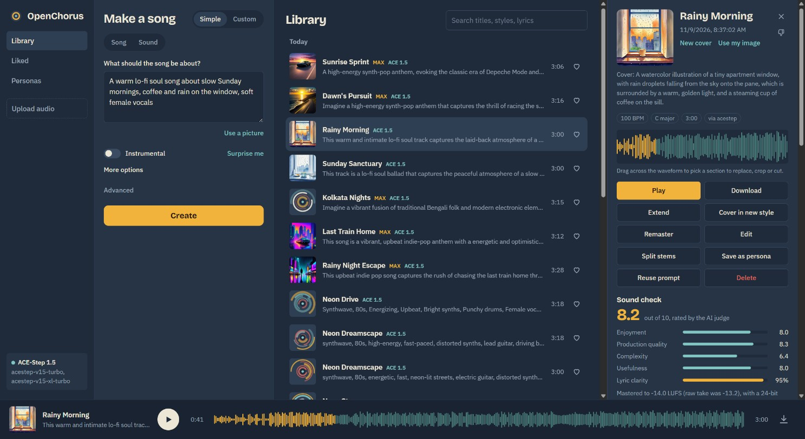
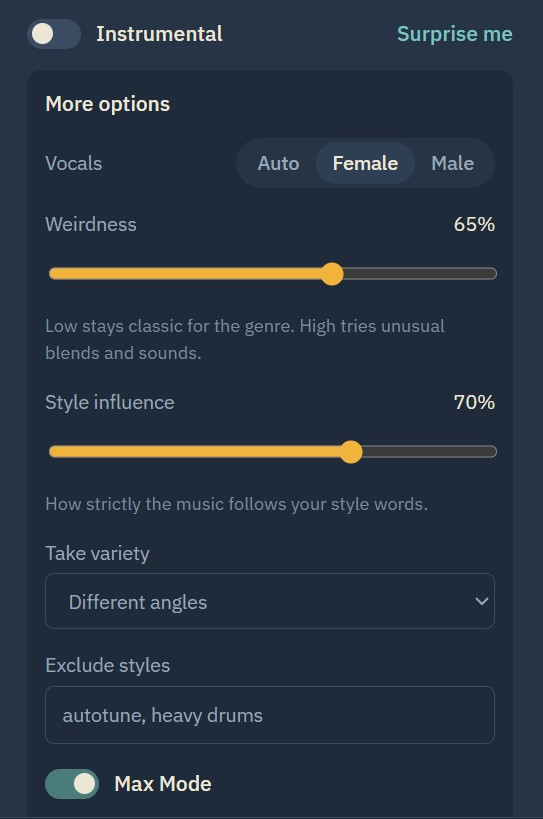
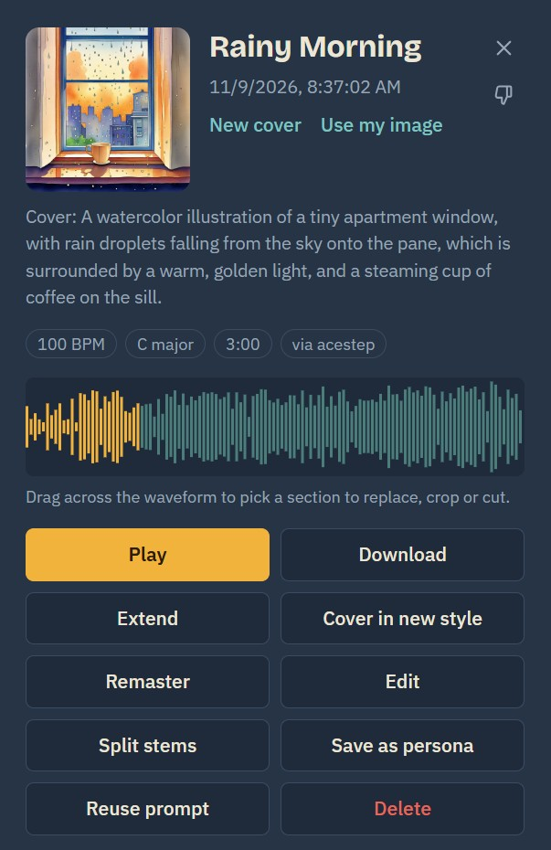
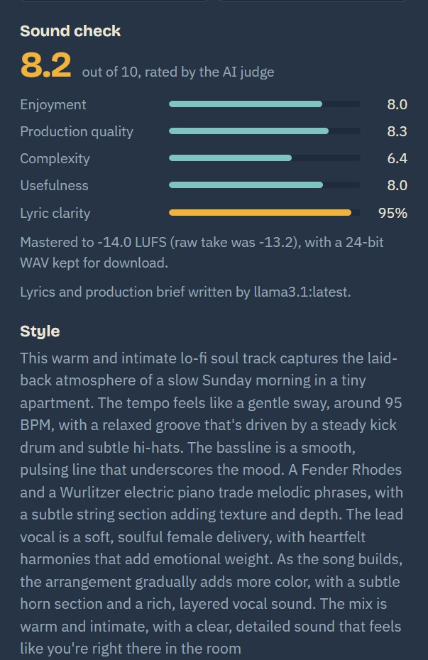
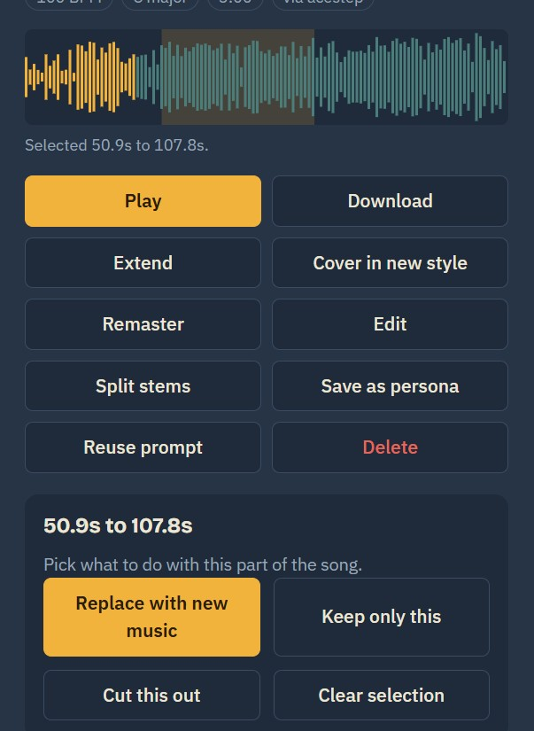
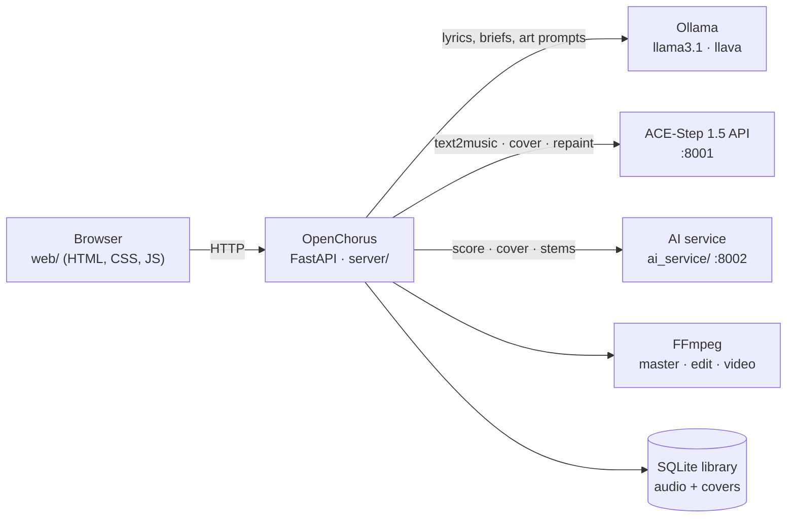

<div align="center">


# OpenChorus

**A free, open-source song studio that runs on your own computer.**
Describe a song or paste your lyrics and get two full, mastered tracks with vocals and cover art.
Then extend, cover, remaster, edit, split stems and download them.

[](https://github.com/kshivam4781/openchorus/actions/workflows/ci.yml)
[](https://github.com/kshivam4781/openchorus/actions/workflows/codeql.yml)
[](https://github.com/kshivam4781/openchorus/releases)
[](LICENSE)
[](https://www.python.org/)
[](https://github.com/ace-step/ACE-Step-1.5)

[Features](#features) · [Quick start](#quick-start) · [Real AI songs](#turn-on-real-ai-songs-ace-step-15) · [AI service](#the-ai-service) · [How it works](#how-it-works) · [API](#api) · [Roadmap](docs/ROADMAP.md)



</div>

No account, no credits, no monthly limit, and your songs never leave your machine.
Everything runs on open models: music from [ACE-Step 1.5](https://github.com/ace-step/ACE-Step-1.5),
lyrics from a local LLM in [Ollama](https://ollama.com), cover art from
[SSD-1B](https://huggingface.co/segmind/SSD-1B), stems from
[Demucs](https://github.com/facebookresearch/demucs).

## Features

| | |
|---|---|
| **Simple mode** | One sentence in. A local LLM writes a different title, structured lyrics and a production brief for every take. |
| **Custom mode** | Your lyrics with `[Verse]` `[Chorus]` tags, your style of music and title. |
| **Songs and Sounds** | Full songs, or short instrumental clips, loops and effects. |
| **More options** | Vocal gender, Weirdness, Style influence, take variety and Exclude styles. |
| **Max Mode** | Renders twice as many takes and keeps the best by AI quality score and lyric clarity. |
| **Mastering** | Every take is mastered to streaming loudness (-14 LUFS, -1 dBTP). A 24-bit WAV is kept. |
| **Sound check** | An AI judge rates enjoyment, production quality, complexity and usefulness. A speech model checks how many lyrics you can actually hear. |
| **Cover art** | A 1024×1024 album cover painted for every take. Repaint with your own prompt or upload an image. |
| **Use a picture** | A local vision model turns a photo into a song idea. |
| **Extend, Cover, Remaster** | Continue a song, re-record it in a new style, or re-render it at best quality. |
| **Replace section** | Drag across the waveform and regenerate just that part. |
| **Edit** | Crop, cut a section, fade in or out, change speed, reverse. Every edit is a new copy. |
| **Stems** | Vocals, drums, bass and other, or vocals and instrumental. |
| **Personas** | Save a song's sound and reuse it on new lyrics. |
| **Upload** | Bring your own audio, then extend or cover it. |
| **Downloads** | MP3 (320 kbps), WAV (24-bit) and an MP4 video with the cover and a moving waveform. |
| **Library** | Search, like, dislike, rename, delete, live progress for every take. |
| **Languages** | 50+ vocal languages. |

<table>
  <tr>
    <td width="50%"></td>
    <td width="50%"></td>
  </tr>
  <tr>
    <td><b>More options.</b> The same controls you know from hosted song generators, plus Max Mode.</td>
    <td><b>Every song gets a cover</b> and a full set of remix and edit tools.</td>
  </tr>
  <tr>
    <td></td>
    <td></td>
  </tr>
  <tr>
    <td><b>Sound check.</b> A quality score, lyric clarity and loudness for each take.</td>
    <td><b>Drag the waveform</b> to replace, keep or cut any section.</td>
  </tr>
</table>

## What you need

| | Minimum | Tested on |
|---|---|---|
| Try every feature (demo engine, no vocals) | Any computer with Python 3.10+ and FFmpeg. No GPU. | |
| Real songs with vocals (ACE-Step 1.5) | NVIDIA GPU with 6 GB VRAM, 16 GB RAM, ~15 GB disk | Acer Predator Helios Neo 16 laptop: RTX 5070 Ti Laptop GPU (12 GB), Intel Core Ultra 9 275HX, 32 GB RAM, Windows 11 |
| Everything (covers, ratings, Max Mode, 4 stems) | NVIDIA GPU with 8 GB+ VRAM, ~25 GB disk | Same laptop |

On the tested laptop a 3-minute song with vocals takes about 25 to 40 seconds, and a full
two-take Max Mode batch with covers and ratings takes a few minutes. Apple Silicon, AMD and
CPU-only machines also work through ACE-Step's own backends, just slower.

## Quick start

You need Python 3.10+ and [FFmpeg](https://ffmpeg.org/download.html) on your PATH.

| System | Install the two prerequisites |
|---|---|
| Windows 10/11 | `winget install Python.Python.3.12 Gyan.FFmpeg` |
| macOS | `brew install python@3.12 ffmpeg` (the built-in `python3` is 3.9, too old; the scripts find the newer one) |
| Ubuntu / Debian | `sudo apt install python3 python3-venv ffmpeg` |
| Fedora | `sudo dnf install python3 ffmpeg` |

```bash
git clone https://github.com/kshivam4781/openchorus
cd openchorus
./start.sh          # Windows: start.bat
```

Then open **http://127.0.0.1:7777**.

Out of the box the app runs on the **demo engine**, a small offline synthesizer that makes
instrumental sketches. It lets you try every feature without a GPU. For real songs with
vocals, start ACE-Step next to it (below). The page switches over by itself.

<details>
<summary>Run with Docker</summary>

```bash
docker run -p 7777:7777 -v openchorus-data:/data ghcr.io/kshivam4781/openchorus:latest
```

To use an ACE-Step server running on the same machine, point the container at it:
`-e ACESTEP_URL=http://host.docker.internal:8001` (on Linux also add
`--add-host=host.docker.internal:host-gateway`).

For a GPU setup with ACE-Step in a second container, clone ACE-Step next to this folder
(`../ACE-Step-1.5`), install the NVIDIA container toolkit and run `docker compose up --build`.
</details>

## Turn on real AI songs (ACE-Step 1.5)

Recommended: an NVIDIA GPU with 6 GB+ VRAM. Apple Silicon, AMD (ROCm), Intel XPU and CPU
are supported by ACE-Step too, just slower. The setup scripts also need `git`.
`start_all` turns on ACE-Step's faster audio decoding only on NVIDIA cards with 11 GB or more,
so smaller cards keep its memory-safe defaults.

**Windows:** run `setup_acestep.bat` once (it installs ACE-Step next to this folder),
then `start_all.bat` starts everything and `stop_all.bat` stops it.

**macOS / Linux:**

```bash
./setup_acestep.sh          # once: clones ACE-Step-1.5 next to this folder (first run downloads ~10 GB)
./start_all.sh              # starts ACE-Step, the AI service (if installed) and OpenChorus; logs in ./logs
./stop_all.sh               # stops them
```

Or by hand:

```bash
git clone https://github.com/ace-step/ACE-Step-1.5
cd ACE-Step-1.5
uv sync
uv run acestep-api          # http://127.0.0.1:8001, models download on first run
```

Which ACE-Step model to use, by VRAM (from ACE-Step's own guide):

| VRAM | DiT model | Language model |
|---|---|---|
| 6 GB or less | 2B turbo | none |
| 6 to 8 GB | 2B turbo | `acestep-5Hz-lm-0.6B` (pt backend) |
| 8 to 16 GB | 2B turbo or sft | 0.6B or 1.7B |
| 16 to 24 GB | XL turbo | 1.7B |
| 24 GB+ | XL sft | 4B |

For the best Simple mode, install [Ollama](https://ollama.com) and run `ollama pull llama3.1`.
OpenChorus uses it to write lyrics and a production brief for each take, and falls back to
ACE-Step's own planner when Ollama is not running.

## The AI service

An optional second server, [`ai_service/`](ai_service/server.py), runs the extra models on
the GPU next to ACE-Step:

| Model | What it does |
|---|---|
| [audiobox-aesthetics](https://github.com/facebookresearch/audiobox-aesthetics) | Rates every song and picks the winners in Max Mode |
| [faster-whisper large-v3-turbo](https://github.com/SYSTRAN/faster-whisper) | Lyric clarity: how many requested words can be heard |
| [SSD-1B](https://huggingface.co/segmind/SSD-1B) + [LCM-LoRA](https://huggingface.co/latent-consistency/lcm-lora-ssd-1b) | 1024×1024 cover art in a few seconds |
| [Demucs htdemucs](https://github.com/facebookresearch/demucs) | 2 or 4 stem separation |

Install it once with `setup_ai_service.bat` on Windows or `./setup_ai_service.sh` on macOS and
Linux (about 8 GB of downloads); `start_all` then starts it on port 8002. The setup picks the
right PyTorch build: CUDA on NVIDIA, Apple Silicon (MPS) on a Mac, and the CPU build otherwise. It loads each model only when needed and frees GPU memory after
each job so it fits beside the music model on a 12 GB card. Without it everything still works:
songs get the tape-reel artwork and no rating.

If Hugging Face downloads stall on your network, fetch models with
`python tools/fetch_models.py <repo> ai_service/models/<name>`. It downloads in resumable
parallel parts, and the service uses anything it finds in `ai_service/models`.

Image inspiration uses a vision model in Ollama: `ollama pull llava:7b`.

## Quality, measured

`tools/bench_quality.py` renders four fixed songs (pop, rock, folk, EDM) through the full
pipeline, then `tools/bench_wer.py` adds AI judge scores and lyric word error rate.
On an RTX 5070 Ti laptop GPU (12 GB), 2-minute songs, High quality:

| ACE-Step setup | Judge score (1-10) | Lyric word error | Time per song |
|---|---|---|---|
| 2B turbo + 0.6B LM (default) | **7.97** | **0.59** | ~25 s |
| 2B turbo + 1.7B LM | 7.77 | 0.87 | ~25 s |

The smaller planner LM won on both counts on this card, so it is the default.
A live Max Mode run scored 8.0 with 96% of the lyrics intelligible.

## How it works



1. **Plan.** In Simple mode the planner asks a local LLM for one distinct plan per take:
   title, lyrics with section tags, a 45 to 90 word production brief, tempo, key, length and an
   art prompt. Plans with thin lyrics are rejected and retried.
2. **Render.** Each plan goes to ACE-Step in Custom mode (`text2music`). Max Mode renders
   two candidates per take and keeps the one with the higher judge score plus lyric clarity.
3. **Polish.** Each take is mastered with a two-pass loudness normalisation, then rated.
4. **Paint.** The AI service paints the cover from the plan's art prompt.

Feature mapping in `server/engines/acestep.py`: create → `text2music`, cover → `cover`,
replace section → `repaint`, extend → pad and `repaint` the new tail,
persona → `reference_audio`. The front end is plain HTML, CSS and JavaScript with no build step.

## Troubleshooting

| Problem | Fix |
|---|---|
| The sidebar says "Demo synth" | ACE-Step is not running or is still loading its models. Start it with `start_all`, wait a minute, and the app switches by itself. |
| Songs have no vocals | You are on the demo engine. See above. |
| No cover art, no rating | The AI service is not installed or not running (`setup_ai_service`, then `start_all`). |
| Model downloads stall at 0% | Use `python tools/fetch_models.py <repo> <folder>`, which downloads in resumable parallel parts. |
| Everything is twice as slow on a laptop | Plug it in. On battery, Windows caps the GPU. |
| "Address already in use" | Something else uses port 7777. Set `OPENCHORUS_PORT=7778`. |
| "OpenChorus needs Python 3.10 or newer" | Install a newer Python (see Quick start). On a Mac, `brew install python@3.12`. |
| "Could not create a virtual environment" | Debian and Ubuntu ship Python without venv: `sudo apt install python3-venv`. |
| Something did not start | Each part writes a log in the `logs` folder: `openchorus.log`, `acestep.log`, `ai_service.log`. |
| ACE-Step closes right after starting on Windows | Use `start_all.bat`, which sets UTF-8 output. ACE-Step prints emoji that crash Python when its output goes to a log file. |

## Configuration

Copy `.env.example` to `.env`. Everything is optional.

| Variable | Default | What it does |
|---|---|---|
| `OPENCHORUS_ENGINE` | `auto` | `auto` uses ACE-Step when it answers, else the demo engine. `acestep` or `demo` force one. |
| `ACESTEP_URL` | `http://127.0.0.1:8001` | Where the ACE-Step API runs. Can be another machine on your network. |
| `ACESTEP_API_KEY` | empty | Set it if you started ACE-Step with `--api-key`. |
| `ACESTEP_MODEL` | empty | Pick a DiT model, e.g. `acestep-v15-xl-turbo`. Empty uses ACE-Step's default. |
| `ACESTEP_THINKING` | `true` | Let the language model plan the song in Custom mode too (better quality, slower). |
| `ACESTEP_STEPS` | `8` | Diffusion steps. 8 for turbo models, 32 to 64 for base or sft. |
| `OPENCHORUS_PLANNER` | `auto` | `auto` uses Ollama when it is running; `acestep` always uses ACE-Step's planner. |
| `OLLAMA_URL` / `OLLAMA_MODEL` | `http://127.0.0.1:11434` / `llama3.1` | The planner model. |
| `OLLAMA_VISION_MODEL` | `llava:7b` | Vision model for "Use a picture". |
| `OPENCHORUS_MASTERING` | `true` | Master every take to `OPENCHORUS_MASTER_LUFS` (default -14). |
| `AUX_URL` | `http://127.0.0.1:8002` | Where the AI service runs. |
| `OPENCHORUS_DATA` | `./data` | Library database, audio and cover files. |
| `OPENCHORUS_HOST` / `OPENCHORUS_PORT` | `127.0.0.1` / `7777` | Web server address. |

## API

Interactive docs at **http://127.0.0.1:7777/docs**.

| Method | Path | |
|---|---|---|
| POST | `/api/generate` | `{mode, kind, description, title, style, lyrics, instrumental, variations, duration, bpm, key_scale, seed, persona_id, quality, vocal_gender, weirdness, style_influence, variety, exclude_styles, max_mode}` |
| GET | `/api/songs` | `?liked=true&q=text` |
| GET / PATCH / DELETE | `/api/songs/{id}` | PATCH takes `{title, liked, disliked}` |
| GET | `/api/songs/{id}/audio` | `?download=1&format=mp3\|wav\|mp4` |
| POST | `/api/songs/{id}/extend` | `{seconds, lyrics, style}` |
| POST | `/api/songs/{id}/cover` | `{style, strength, lyrics}` (a new recording, not artwork) |
| POST | `/api/songs/{id}/replace` | `{start, end, lyrics}` |
| POST | `/api/songs/{id}/remaster` | |
| POST | `/api/songs/{id}/edit` | `{op: crop\|remove\|reverse\|speed\|fade_in\|fade_out, start, end, factor, seconds}` |
| POST | `/api/songs/{id}/stems` | `{stems: 2\|4}` |
| GET / POST | `/api/songs/{id}/art` | GET the cover image; POST `{prompt}` to paint a new one |
| POST | `/api/songs/{id}/art/upload` | multipart `file` (JPG, PNG, WebP) |
| POST | `/api/inspire` | multipart `file` image, optional `note`: returns a song idea |
| POST | `/api/upload` | multipart `file` |
| GET / POST / DELETE | `/api/personas` | POST takes `{song_id, name}` |
| POST | `/api/lyrics` | `{prompt, style}` |
| GET | `/api/status` | version, engine, AI service, vision model, mastering, queue |

## Development

```bash
pip install -r requirements-dev.txt
python -m playwright install chromium
ruff check .                     # lint
pytest                           # 50 API, engine-contract and planner tests, no GPU needed
python tests/run_e2e.py          # real Chromium run through every feature
```

CI runs lint and shellcheck, tests on Linux, Windows and macOS (Python 3.10, 3.12 and 3.13),
the one-click start and stop scripts on all three systems, the browser end-to-end run,
a Docker build and CodeQL on every push. Tagging `vX.Y.Z` publishes a multi-arch image to
GitHub Container Registry. See [CONTRIBUTING.md](CONTRIBUTING.md).

```
server/            FastAPI app, library, planner, engines, audio tools
  engines/         acestep.py (REST client), demo.py (offline synth), base.py
web/               the single-page app
ai_service/        optional GPU sidecar: judge, Whisper, cover art, Demucs
tools/             benchmarks and the model fetcher
tests/             pytest suites and the Playwright e2e run
docs/              roadmap, clean-room notes, screenshots
```

## Roadmap

Next up: synced karaoke lyrics, automatic re-rolls for mumbled takes, best-section stitching,
playlists and radio, LAN sharing with sign-in, and LoRA training on your own songs.
See [docs/ROADMAP.md](docs/ROADMAP.md).

## Using it responsibly

Generated music can resemble existing work. Don't prompt for living artists' names or paste
lyrics you don't own, disclose AI involvement where it matters, and check the originality of
anything you release. The licenses and disclaimers of the underlying models apply to the output.

OpenChorus is an independent project. It is not affiliated with or endorsed by Suno or any
other music service, and it contains no code or assets from them. See
[docs/REVERSE_ENGINEERING.md](docs/REVERSE_ENGINEERING.md) for how the feature study was done.

## License

[MIT](LICENSE) © Shivam Singh. Models and libraries keep their own licenses: see
[THIRD_PARTY_NOTICES.md](THIRD_PARTY_NOTICES.md).

## Acknowledgements

[ACE-Step](https://github.com/ace-step/ACE-Step-1.5) by ACE Studio and StepFun ·
[audiobox-aesthetics](https://github.com/facebookresearch/audiobox-aesthetics) and
[Demucs](https://github.com/facebookresearch/demucs) by Meta ·
[SSD-1B](https://huggingface.co/segmind/SSD-1B) by Segmind ·
[LCM-LoRA](https://huggingface.co/latent-consistency) ·
[faster-whisper](https://github.com/SYSTRAN/faster-whisper) ·
[Ollama](https://ollama.com) · [FFmpeg](https://ffmpeg.org)
